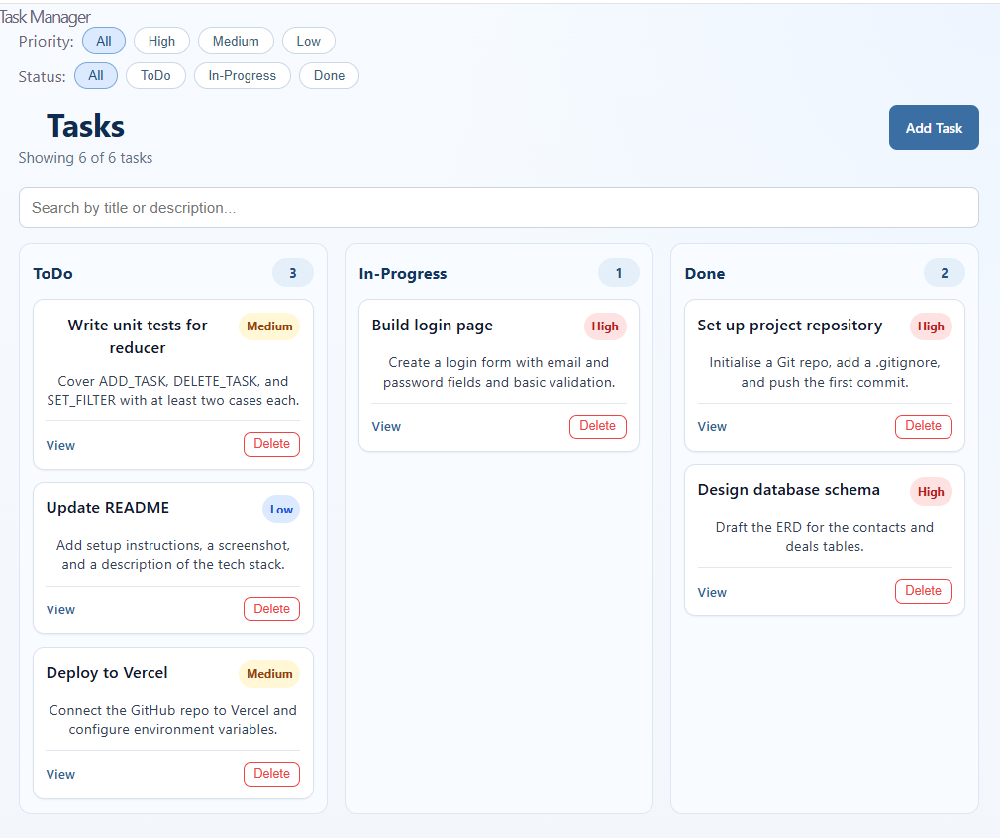
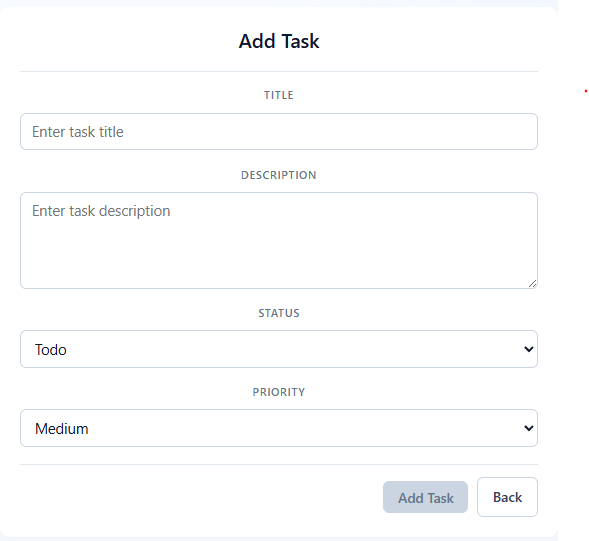
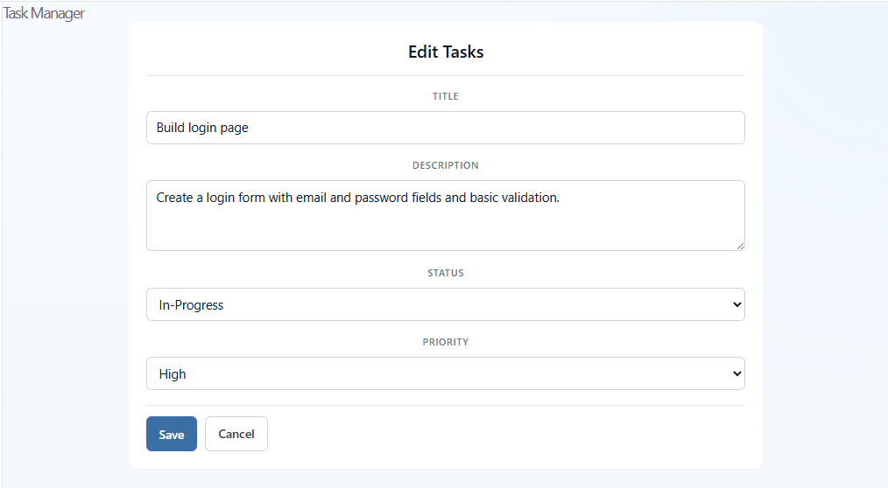

# Task Manager (React + Vite)

A simple task management web app built with React and Vite.

## How to Install and Run the Project

### 1. Prerequisites
- Node.js (LTS version recommended)
- npm

### 2. Install Dependencies
```bash
npm install
```

### 3. Run in Development Mode
```bash
npm run dev
```

Then open the local URL shown in terminal (usually `http://localhost:5173`).

### Backend API

The app defaults to `https://module3-taskflow-api-production-9bee.up.railway.app/api`.
To use a different backend, set `VITE_API_BASE_URL` in a local `.env` file, using
`.env.example` as the reference. Include `/api`, but not `/tasks`. Restart Vite
after changing this value. Production builds embed this value at build time.

During development, requests use `/api` through Vite's proxy to the configured
backend. This avoids the deployed backend's current browser CORS restriction.
Production builds call the configured backend directly and still require backend
CORS configuration, or a same-origin reverse proxy with `VITE_API_BASE_URL=/api`.

Task data is loaded from the server, not from the old local task cache. Requests
use GET/POST `/tasks`, GET/PUT/DELETE `/tasks/{id}`, and PUT `/tasks/{id}/complete`.
The backend assigns task IDs. Failed writes leave the current task state and
form values unchanged.

Server-provided status and priority take precedence over local board metadata.
The client also supports responses that use `completed` instead: completed tasks
appear in Done, and other tasks default to ToDo. When the backend omits status or
priority, the In-Progress label and priority are saved only in this browser.
Card order is always browser-only because the API has no ordering endpoint.
Writes use the fields observed in the server's task responses. With the
completion-only schema, moving a task out of Done updates `completed` to false.

The backend must allow cross-origin requests from the frontend's origin, including
the JSON POST/PUT and DELETE preflight requests.

### 4. Build for Production
```bash
npm run build
```

### 5. Preview Production Build
```bash
npm run preview
```

## Main Feature Screenshot

Task board with status columns and filters:



## Bonus Challenge Completed

### Beginner Challenge
- Show task count summary: `Showing X of Y Tasks` (refer to `Image_MainPage`)
- Disable Add Task form submit button when required fields are missing (refer to `Image_AddTask`)

### Medium Challenge
- Persist tasks using the backend API, with board metadata in Local Storage
- Add `UPDATE_TASK` support on Edit Task page (refer to `Image_UpdateTask`)

### Hard Challenge
- Add a priority filter above the status filters (refer to `Image_MainPage`)

## AI Supported Area (GitHub Copilot)
- Troubleshooting the project issues
- Enhancing cosmetic layout for UI components (mainly module CSS updates)
- generate of readMe

## Reference Images
- Image_MainPage:
  
- Image_AddTask:
  
- Image_UpdateTask: 
  